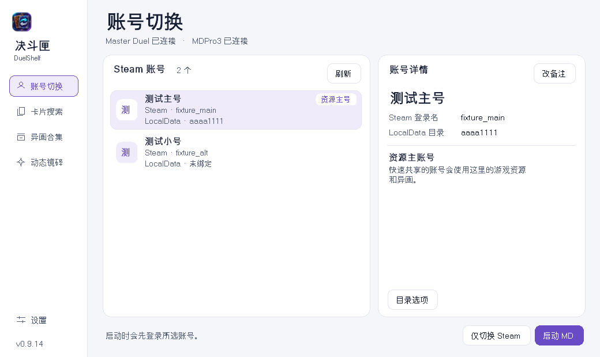

# 决斗匣 · DuelShelf

《游戏王 Master Duel》桌面工具。切换本机 Steam 账号、复用已下载的游戏资源，并按账号设置异画、卡片演出和动态镜碎。

| 平台 | 安装包 | 需要准备 |
| --- | --- | --- |
| Windows 10 / 11 x64 | [下载 ZIP](https://github.com/oldwangnewbe/md-switcher/releases/download/v0.9.20/DuelShelf-Windows-x64-0.9.20.zip) | 安装 Steam 和《Master Duel》 |
| macOS 13+ · Apple Silicon | [下载 DMG](https://github.com/oldwangnewbe/md-switcher/releases/download/v0.9.20/DuelShelf-macOS-arm64-0.9.20.dmg) | 在同一个 CrossOver 容器里安装 Steam 和《Master Duel》 |

## Windows 怎么用

1. 解压整个 ZIP，运行 `DuelShelf.exe`。将 `CardEngine` 和 `RoyalFinish` 留在程序旁边。
2. 在 Steam 登录需要切换的账号并选择记住登录。打开决斗匣的「账号切换」，点「刷新」。列表来自本机 Steam 保存的账号记录。
3. 退出游戏，在决斗匣选中账号，点「启动 MD」。只想登录 Steam 时，点「仅切换 Steam」。Steam Guard 验证在 Steam 里完成。

要复用资源，在「账号切换」选中已下载完整资源的账号，点「设为资源主账号」。小号首次进入游戏后退出，再选中它并点「绑定游戏目录」。在同一 NTFS 卷上可点「快速共享主号缓存」。共享中的小号会同步主号的异画，需要单独换异画时先点「恢复原缓存」。 [Windows 详细说明](Windows/README.md)

查看 Windows 账号切换界面

## macOS 怎么用

1. 打开 DMG，把 `DuelShelf.app` 拖到「应用程序」。安装包使用临时签名，首次打开时 macOS 可能拦截。升级时先退出旧版，将旧应用移出「应用程序」，再拖入新版。原有设置会继续使用。
2. 在 CrossOver 容器里的 Steam 登录并记住账号。在决斗匣的「账号切换」点「刷新」。找不到游戏时，去「设置 → 安装目录」选择游戏文件夹。
3. 退出游戏，选中账号并点「启动 MD」或「仅切换 Steam」。需要开机运行时，去「设置 → 登录与快捷键」开启自启动。按 **Control + Option + M** 可叫回窗口。

要复用资源，在「账号切换」的「游戏资源」菜单设置资源主账号。小号首次使用时可选「启动并识别新号目录」，完成识别后再用决斗匣启动。

查看 macOS 账号切换和设置界面

[安装目录与快捷键设置截图](docs/images/settings.png)

## 异画、镜碎和卡片演出

- **异画**：在「设置」连接本机 MDPro3。退出游戏后，从「卡片搜索」预览并应用普通或超框异画，或用「异画合集」批量应用、恢复原画。有对应演出的画款会提示是否一并应用。
- **动态镜碎**：选中账号，在「动态镜碎」按卡片或合集开启。保持决斗匣运行，下次从决斗匣或 Steam 启动游戏时会自动加载。效果仅在本机显示。
- **卡片演出**：在「卡片演出」按卡名或画款编号查找。可替换已有的召唤或发动演出，也可为符合条件的卡新增召唤演出。支持恢复原演出。

> 异画和动画会修改本地资源，动态镜碎会向游戏进程加载 DLL。请先备份并核对游戏与平台条款。游戏更新可能导致功能失效，运营方也可能限制账号使用。项目供个人学习和非商业使用，安装包不附带游戏素材。

[使用风险、素材来源与构建方式](docs/implementation.md) · [所有发行版](https://github.com/oldwangnewbe/md-switcher/releases)
