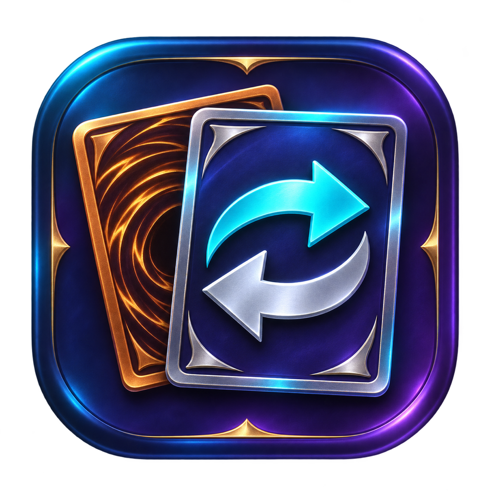
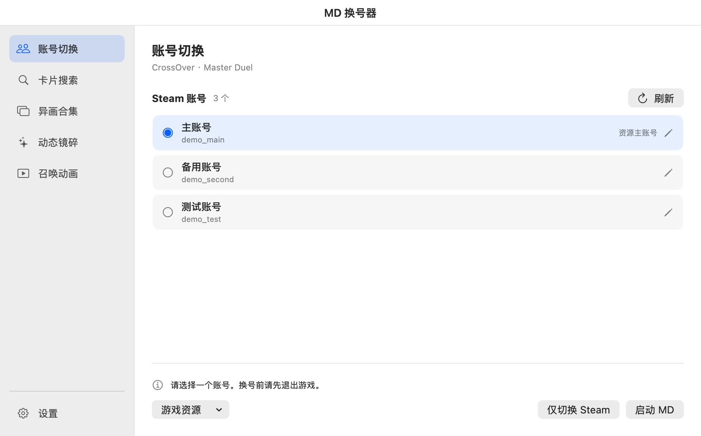
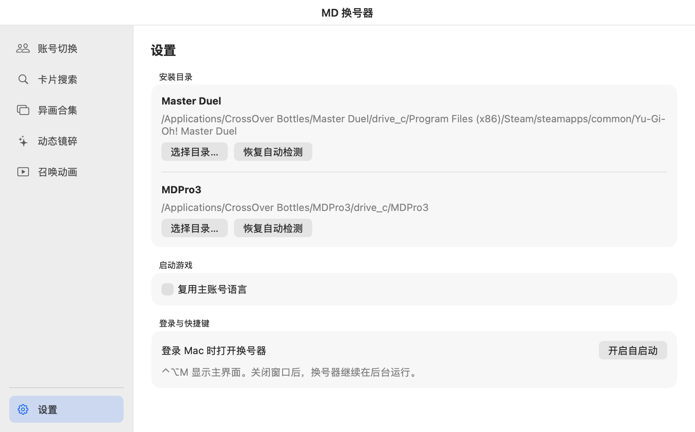

# MD 换号器

在 Apple Silicon Mac 上切换 CrossOver 里的 Steam 账号，启动《游戏王 Master Duel》，并按账号设置本地异画和动态镜碎。

**[下载 macOS 安装包](https://github.com/oldwangnewbe/md-switcher/releases/download/v0.9.13/MD-Switcher-0.9.13-arm64.dmg)** · [查看发行版](https://github.com/oldwangnewbe/md-switcher/releases/latest)

## 安装与换号

需要 **Apple Silicon、macOS 13+、CrossOver**，以及装在 CrossOver 容器里的 Steam 和《Master Duel》。安装包已做临时签名，尚未通过 Apple 公证，macOS 首次打开时可能拦截。

1. 打开下载的 DMG，把 **MD Switcher.app** 拖到「应用程序」，再从那里打开。
2. 在 CrossOver 的 Steam 里登录要切换的账号，勾选「记住登录」。返回换号器点「刷新」。
3. 先退出游戏，再选账号并点「启动 MD」。只想登录 Steam 时，点「仅切换 Steam」。遇到 Steam Guard 验证时，在 Steam 里完成。

找不到游戏时，在左侧「设置 → 安装目录」手动选择。需要自启动时，在「设置 → 登录与快捷键」点「开启自启动」。换号器在后台运行时，按 **Control + Option + M** 叫回主界面。

## 其他功能

| 想做什么 | 从哪里开始 |
| --- | --- |
| 复用已下载的资源 | 选一个下载完成的账号，在「游戏资源」设为资源主账号。之后用换号器启动其他账号。 |
| 换异画或召唤动画 | 在「设置」选好本机 MDPro3，再到「卡片搜索」选异画并应用，或到「异画合集」批量应用。召唤动画支持替换已有演出。 |
| 开启动态镜碎 | 在「动态镜碎」选卡并为账号开启。保持换号器在后台，从换号器或 Steam 启动游戏都会加载。效果仅在本机显示。 |

## 使用前须知

- **账号风险**：异画和动画会修改本地游戏资源，动态镜碎会向游戏进程加载 DLL。请自行确认使用方式符合游戏和平台条款，运营方可能限制账号。[KONAMI 使用条款](https://legal.konami.com/games/yugioh_masterduel/terms/tou/cs_other/en/)
- **文件和兼容性风险**：先备份。游戏或 CrossOver 更新后，功能可能失效、引发崩溃或导致资源重新下载。出现问题时，可退出游戏后恢复原画、演出或备份资源。
- **个人使用**：本项目独立开发，仅供个人学习和非商业使用，按现状提供。安装包不附带游戏素材，异画和动画从用户本机的 MDPro3 读取。

[查看实现方式、素材来源、完整免责声明与构建步骤](docs/implementation.md)
